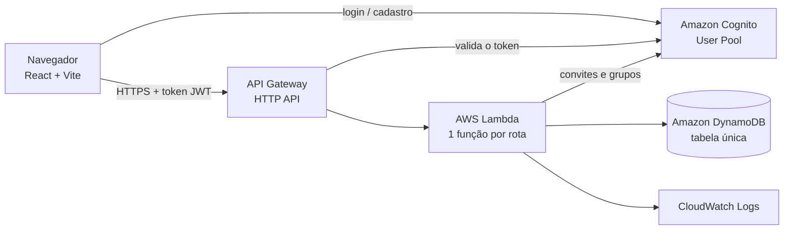

# Gestão Pro

Plataforma SaaS de gestão para pequenas empresas, **multiempresa**: cada empresa tem os seus clientes, produtos,
estoque, vendas e equipe, totalmente isolados das demais. Projeto de estudo, construído em TypeScript de ponta a ponta
e hospedado em serviços **serverless** da AWS.

> Status: em desenvolvimento. Etapas 1 a 11 concluídas (ver [Roteiro](#roteiro)). O pagamento dos planos é **simulado**.

---

## O que a ferramenta faz

| Módulo | O que oferece |
|---|---|
| Autenticação | Cadastro com confirmação por e-mail, login, troca de senha, convite de funcionários |
| Onboarding | Cadastro da empresa por **CNPJ** ou do profissional por **CPF** (com validação dos dígitos) |
| Funcionários | O Supervisor convida, bloqueia e libera funcionários; reenvio de convite |
| Produtos | Cadastro com SKU único, categoria, unidade, preço e custo (o custo só aparece para o Supervisor) |
| Estoque | Entradas, saídas e ajustes com histórico; somente o Supervisor altera o estoque |
| Clientes | Cadastro com CPF/CNPJ opcional, endereço com busca de CEP; transferência de atendimento entre vendedores |
| Vendas | Carrinho com vários produtos, desconto e forma de pagamento; **baixa automática do estoque** e bloqueio sem estoque; cancelamento com aprovação |
| Dashboard | Vendas do mês, ranking de produtos e vendedores, últimos compradores, gráfico diário |
| Planos | Básico, Profissional e Premium, que liberam funcionários e ferramentas extras (pagamento simulado) |
| Painel do SuperAdmin | Visão de todas as empresas e usuários, bloqueio de acesso, ajuste de plano e suporte aos clientes |

### Perfis de acesso

| Perfil | Grupo no Cognito | Pode |
|---|---|---|
| **SuperAdmin** | `SuperAdmin` | Ver todas as empresas e usuários, bloquear/liberar acessos, ajustar planos e dar suporte (ex.: transferir atendimento) |
| **Supervisor** | `Dono` | Controlar toda a empresa: funcionários, produtos, **estoque**, clientes e vendas |
| **Funcionário** | `Funcionario` | Cadastrar e atender **os próprios** clientes e registrar **as próprias** vendas; vê produtos, mas não altera o estoque |

---

## Arquitetura



1. O usuário faz login pelo **Cognito**, que devolve um token assinado (JWT) com o id do usuário, o grupo e a empresa.
2. O site chama a **HTTP API** enviando esse token. Um autorizador JWT confere a assinatura e a validade **antes**
   de qualquer código rodar: token inválido recebe 401.
3. Cada rota tem a **sua própria Lambda**, com a sua própria permissão (IAM) restrita ao que ela precisa.
4. Os dados ficam em uma **tabela única do DynamoDB**. Toda chave começa pelo id da empresa (`EMPRESA#<id>`),
   o que separa os dados de cada empresa na própria estrutura do banco.

### Serviços da AWS utilizados

| Serviço | Para que serve no projeto |
|---|---|
| **Amazon Cognito** (plano Lite) | Cadastro, login, confirmação de e-mail, recuperação de senha e os 3 grupos de acesso |
| **API Gateway – HTTP API** | Porta de entrada da API: CORS, limite de requisições e autorizador JWT do Cognito |
| **AWS Lambda** (Node.js 24, ARM) | Regras de negócio; 28 funções, uma por rota |
| **Amazon DynamoDB** | Banco NoSQL em tabela única, capacidade provisionada fixa |
| **Amazon CloudWatch Logs** | Logs das Lambdas, com retenção de 7 dias |
| **AWS IAM** | Uma role exclusiva por Lambda (menor privilégio) |
| **AWS CloudFormation / CDK** | Toda a infraestrutura descrita em código: cria e apaga tudo com um comando |

Planejados para as próximas etapas: **API Gateway WebSocket** (chat em tempo real) e **S3 + CloudFront** (hospedagem do site).

### Custos

A arquitetura foi escolhida para operar dentro dos limites gratuitos da AWS (serverless, sem servidores ligados
o tempo todo, sem VPC). Os custos da conta são **acompanhados com alertas de orçamento**, e a API tem limite de
requisições por segundo para evitar uso excessivo.

---

## Segurança

| Camada | Como é feito |
|---|---|
| Autenticação | Cognito com fluxo **SRP** (a senha não trafega pela rede); política de senha forte; mensagens de erro que não revelam se um e-mail existe |
| Sessão | Tokens de login valem **15 minutos** e são renovados automaticamente; usuário bloqueado perde o acesso em até 15 minutos |
| Autorização na borda | Todas as rotas exigem token JWT válido, conferido pela HTTP API antes de chamar a Lambda |
| Autorização por perfil | Cada Lambda verifica o grupo do usuário (ex.: só o Supervisor movimenta estoque) |
| Isolamento entre empresas | `empresaId`, `userId` e grupo vêm **sempre do token**, nunca do corpo da requisição; toda consulta usa a empresa do token |
| Dados do vendedor | O Funcionário só acessa clientes e vendas em que ele é o vendedor (`sellerId`) |
| Atributos protegidos | O site **não consegue gravar** o `empresaId` do usuário; só o backend, com permissão administrativa |
| Validação de entrada | Todo corpo, parâmetro de URL e query string é validado com **Zod** (tipos, tamanhos, formatos, CPF/CNPJ) |
| Concorrência | Escritas com condição e transações do DynamoDB (estoque não fica negativo nem é baixado duas vezes) |
| Menor privilégio | Uma role IAM por Lambda, presa à tabela e ao User Pool do projeto |
| CORS | Restrito ao endereço do site |
| Limite de requisições | Throttling na HTTP API (excesso recebe 429 sem executar a Lambda) |
| Erros | Erros inesperados viram uma mensagem genérica (500); detalhes ficam só nos logs |
| Segredos | Nenhuma credencial no repositório; o `.env.local` do site guarda apenas IDs públicos do Cognito e o endereço da API |

---

## Tecnologias

- **Frontend:** React 19, Vite, Tailwind CSS, React Router, React Hook Form, Zod, TanStack Query,
  AWS Amplify (somente Auth), Recharts
- **Backend:** AWS Lambda em Node.js + TypeScript, AWS SDK v3, Zod
- **Infraestrutura:** AWS CDK em TypeScript

## Estrutura de pastas

```
gestao-pro/
├── frontend/src/
│   ├── app/                 rotas, providers e layout
│   ├── components/ui/       componentes visuais reutilizáveis
│   ├── features/<modulo>/   páginas, componentes, hooks e serviços de cada módulo
│   ├── services/            configuração da API e da autenticação
│   └── types/               tipos compartilhados
├── backend/
│   ├── functions/<modulo>/  uma Lambda por rota, separadas por módulo
│   └── shared/              validação, DynamoDB, autenticação, erros e regras comuns
├── infra/                   AWS CDK: stacks de Auth, Database, Api e uma stack por rota
└── docs/                    documentação do projeto
```

## Rotas da API

Todas exigem token do Cognito. Entre parênteses, quem pode usar.

| Módulo | Rotas |
|---|---|
| Empresa | `POST /empresa` (usuário sem empresa) · `GET /empresa` · `POST /empresa/plano` (Supervisor) |
| Funcionários | `GET/POST /funcionarios` · `POST /funcionarios/{userId}/status` · `POST /funcionarios/{userId}/convite` (Supervisor) |
| Produtos | `GET /produtos` (todos) · `POST /produtos` · `PUT /produtos/{productId}` (Supervisor) |
| Estoque | `GET/POST /estoque/movimentos` (Supervisor) |
| Clientes | `GET/POST /clientes` · `PUT /clientes/{customerId}` (Supervisor e Funcionário) · `POST /clientes/transferir` (Supervisor) |
| Vendas | `GET/POST /vendas` (Supervisor e Funcionário) · `POST /vendas/{saleId}/solicitar-cancelamento` (Funcionário) · `POST /vendas/{saleId}/cancelar` · `POST /vendas/{saleId}/recusar-cancelamento` (Supervisor) |
| Admin | `/admin/users`, `/admin/empresas` e sub-rotas (SuperAdmin) |

---

## Como rodar

### Pré-requisitos
- Node.js 24 e npm
- Uma conta AWS com a AWS CLI configurada (`aws configure`) na região `us-east-1`

### 1. Infraestrutura
```bash
cd infra
npm install
npm run deploy        # cria Cognito, DynamoDB, API e Lambdas
```
Ao final, anote as saídas `UserPoolId`, `UserPoolClientId` (stack `GestaoPro-Auth`) e `ApiUrl` (stack `GestaoPro-Api`).

### 2. Site
```bash
cd frontend
npm install
cp .env.example .env.local   # preencha com as saídas do passo anterior
npm run dev                  # abre em http://localhost:5173
```

### 3. Primeiro SuperAdmin
Cadastre-se pelo site e adicione o seu usuário ao grupo `SuperAdmin`:
```bash
aws cognito-idp admin-add-user-to-group \
  --user-pool-id <UserPoolId> --username <seu-email> --group-name SuperAdmin
```

### Apagar tudo
```bash
cd infra && npm run destroy
```

---

## Roteiro

| # | Etapa | Status |
|---|---|---|
| 1 | Proteção de custo e estrutura do projeto | Concluída |
| 2 | CDK + Cognito (3 grupos) + DynamoDB + IAM | Concluída |
| 3 | Telas de login e cadastro | Concluída |
| 4 | Painel do SuperAdmin | Concluída |
| 5 | Onboarding da empresa (CNPJ/CPF) + pagamento simulado | Concluída |
| 6 | Funcionários | Concluída |
| 7 | Produtos e estoque | Concluída |
| 8 | Clientes | Concluída |
| 9 | Vendas | Concluída |
| 10 | Dashboard | Concluída |
| 11 | Planos e liberação de ferramentas | Concluída |
| 12 | Chat em tempo real (WebSocket) | Prévia visual pronta; backend pendente |
| 13 | Automações e marketing | Pendente |
| 14 | Relatórios | Pendente |
| 15 | Deploy (S3 + CloudFront) | Pendente |
